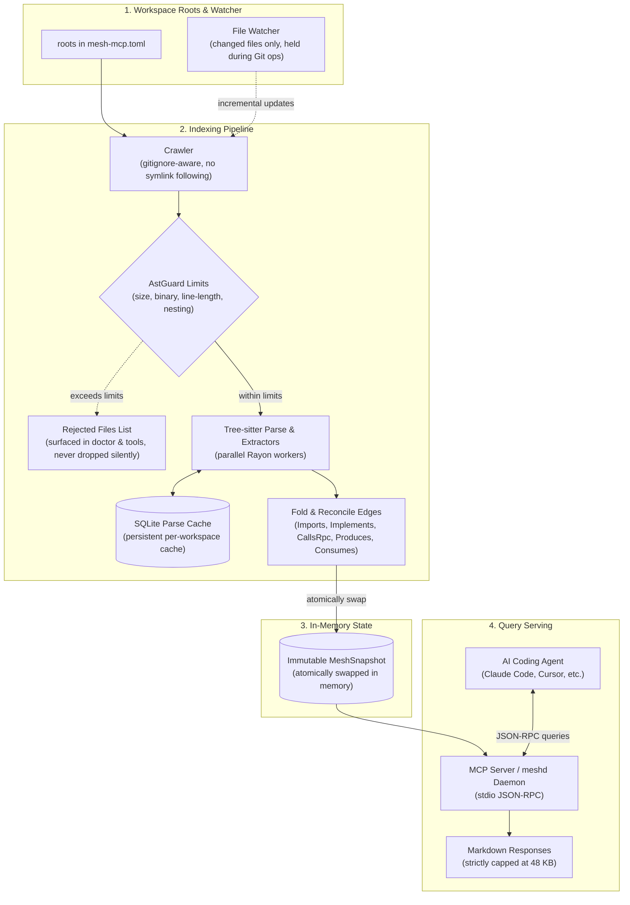

# MeshMCP

[](LICENSE-APACHE)

MeshMCP is a local [Model Context Protocol](https://modelcontextprotocol.io) server, written in
Rust, that indexes a multi-language, multi-service codebase and answers structural questions for
an AI coding agent: where a symbol is declared, who depends on a contract, which services
implement and call a gRPC method, who produces and consumes an event, and what the team's own
documentation says. It runs on the developer's machine, reads only the directories it is
configured with, and its runtime binaries (`mesh-mcp`, `meshd`) contain no network client code; only the installer downloads anything.

---

## The problem

A coding agent explores a repository the way a newcomer does: it greps, opens files one at a
time, and infers relationships from names. In a single-language repository this works. In a
workspace where a `.proto` contract is implemented in Go, called from TypeScript and Java, and
followed by Kafka events consumed in Python, the relationships the agent needs are spread across
files it has no reason to open. The usual results are missed callers, changes that break a
consumer in another service, and a context window filled with function bodies that were only
read to find a signature.

MeshMCP builds that cross-service map once, keeps it in memory, updates it as files change, and
exposes it through six MCP tools.

---

## What it is for, and what it is not

**Fits**
- Cross-repository questions in a polyglot workspace: who imports this package, which services
  implement and call this RPC, who produces and consumes this event, what a route handler touches.
- Checking a change before making it: the blast radius of a contract, and whether an edit to a
  `.proto` breaks the wire format against a Git base.
- Reading less: declarations come back with function bodies stripped, ranked and paginated.
- Looking up the team's own ADRs and Markdown docs from the same server.

**Does not do**
- It is not a language server. There is no type inference and no intra-language call graph: it
  records declarations, imports and the contract idioms listed in [docs/parser-support.md](docs/parser-support.md).
- It does not see what is built at runtime: a topic name read from a registry or config, a route
  assembled from variables, reflection, generated code outside the workspace. These show up as
  "not statically resolved", not as a fact.
- HTTP client calls (`fetch`, `axios`, `HttpService`) are not linked to the routes they hit.
- It does not link tests to the code they cover, and no MCP tool writes to your files (only the `init` and `install-hooks` commands do).

---

## The six tools

| Tool | Answers |
| :--- | :--- |
| `smart_search` | Where is a symbol or an HTTP route (`PATCH /events/:id/state`) declared? Returns signatures with bodies stripped, ranked and paginated. |
| `find_dependents` | Who imports or depends on this type, package or contract? One row per declaration, file or dependent package. |
| `analyze_grpc` | Where is this RPC defined, implemented and called? Also checks the `.proto` for wire-format breaking changes against a Git base. |
| `analyze_impact` | What is affected if this RPC, service, topic, event or HTTP route handler changes? One table row per impacted element, marked `INTERNAL`/`EXTERNAL` with edge confidence; `depth` follows re-emissions across hops. |
| `search_docs` | What do our Markdown docs, ADRs and RFCs say about this term? |
| `visualize_mesh` | Per-service topology as Mermaid, JSON or HTML, bounded in size, with zoom (a zoom also lists the service's HTTP routes in Mermaid). |

Arguments, output formats and error handling: [docs/mcp-tools.md](docs/mcp-tools.md).

---

## Installation

**Prebuilt binaries (recommended).** `install.sh` downloads the rolling `latest` build of `main` for macOS
(arm64, x86-64), Linux x86-64 and Windows x86-64, and falls back to `cargo install` elsewhere:

```bash
curl -fsSL https://raw.githubusercontent.com/VictorAgahi/causalmesh/main/install.sh | bash
```

**Connect an agent:**

```bash
claude mcp add mesh-mcp -- mesh-mcp run          # Claude Code
mesh-mcp doctor                                   # config, roots, parsers, daemon, cache, index health
```

**Pilot install from a checkout** (macOS or Linux, x86-64 or arm64; builds locally, downloads
nothing, idempotent):

```bash
git clone https://github.com/VictorAgahi/causalmesh.git
cd /path/to/your/workspace
/path/to/causalmesh/scripts/install_pilot.sh        # cargo build --release, then init after confirmation
```

It copies `mesh-mcp` and `meshd` into `~/.local/bin`, runs
`mesh-mcp init --auto --write-ide-config` (keeps an existing config, merges `.mcp.json`,
`.cursor/mcp.json` and `.vscode/mcp.json` without removing other servers) and checks the result with
`mesh-mcp doctor --json`. Building needs Rust 1.90 or newer (`rust-version` in `Cargo.toml`) and a C compiler.

The full walkthrough, including configuration of roots, docs vocabulary, custom patterns, skills
and stop rules, is in [SETUP.md](SETUP.md). A five-language example workspace is in
[`examples/polyglot-shop`](examples/polyglot-shop/README.md).

### CLI

| Command | Purpose |
| :--- | :--- |
| `mesh-mcp run [--standalone]` | MCP server on stdio (daemon-backed by default). Refuses to scan `/`, a drive root or your home directory when no config file is found. |
| `mesh-mcp init --auto [--write-ide-config] [--force]` | Generate `.agents/mesh-mcp.toml` from the directory layout (an existing one is kept unless `--force`); optionally write Claude Code / Cursor / VS Code MCP entries and a managed MeshMCP routing section in `CLAUDE.md` / `AGENTS.md`. |
| `mesh-mcp agent-guide` | Print the setup guide for an AI agent installing MeshMCP for you (Markdown). |
| `mesh-mcp doctor [--fix] [--json]` | Diagnose configuration (including custom patterns), index health, socket, daemon version and the config it serves, cache and sandbox; `--fix` repairs what is safe to repair (never the audit log). |
| `mesh-mcp graph [--format html\|mermaid\|json\|fingerprint] [--open]` | Render the full topology, or print a content fingerprint of the index. |
| `mesh-mcp stats [--since 7d\|24h\|all] [--session ID] [--db PATH] [--json]` | Local audit summary: calls per tool and per agent session, `isError` rate, p50/p95 latency per tool, cache hit rate, `meshd` restarts. `MESH_AUDIT_DB` moves the audit database. |
| `mesh-mcp install-hooks` | Install the Git pre-commit hook. |

`-c, --config <path>` is accepted by every command. Logs go to stderr. Under `mesh-mcp run`, stdout carries only JSON-RPC frames.

---

## How it works



- **Daemon mode (default).** `mesh-mcp run` is a thin stdio proxy to a per-workspace `meshd`
  process (Unix socket on macOS/Linux, named pipe on Windows), so several editor windows on the
  same repository share one index. `meshd` is started on demand and exits after 30 idle minutes.
  `mesh-mcp run --standalone` keeps everything in one process (containers, CI).
- **The daemon follows its config.** Edit `mesh-mcp.toml` and `meshd` applies it without a restart,
  at the cost of what changed: display-only keys swap over the running index, a changed custom
  pattern re-extracts only the files it applies to, anything else rebuilds the index from the
  parse cache. The old state keeps serving until the new one is ready ([SETUP.md](SETUP.md#daemon-vs-standalone)).
- **Persistent parse cache.** One SQLite file per workspace under `~/.cache/mesh-mcp/workspaces/`,
  with a size quota and LRU eviction, so a restart or a branch switch back to known content does
  not re-parse it.
- Details: [docs/architecture.md](docs/architecture.md).

---

## Languages and what is extracted

Verified against `crates/mesh-parsers/src/languages/` at the time of writing: this lists what the extractors recognise, not how accurate they are on your code. Depth per language, with what each one does not get: [docs/parser-support.md](docs/parser-support.md). "Declarations" means
classes, interfaces, functions/methods and similar symbols usable by `smart_search`.

| Language | Declarations | Imports (`find_dependents`) | gRPC | Events / messaging | HTTP endpoints |
| :--- | :---: | :---: | :--- | :--- | :--- |
| Java | yes | yes | `*ImplBase` servers, `@GrpcService`, `newBlockingStub/newStub/newFutureStub` clients | `@KafkaListener`, `KafkaTemplate` | Spring MVC / JAX-RS annotations |
| Go | yes | yes | `Register*Server`, `New*Client` | kafka-go, sarama, confluent-kafka-go | chi / gin / echo-style route calls |
| Python | yes | yes | `*Servicer` servers, `*_pb2_grpc.*Stub(...)` clients | confluent_kafka, aiokafka, Celery | Flask / FastAPI routes (path and method) |
| TypeScript / JavaScript (`.ts`, `.mts`, `.cts`, `.tsx`, `.js`, `.jsx`, `.mjs`, `.cjs`; script blocks of `.vue`, `.svelte`, `.astro`) | yes; CommonJS `require` and dynamic `import()` count as imports, `tsconfig`/`jsconfig` `paths` and `package.json` `imports` aliases are resolved | yes | NestJS `@GrpcMethod`, `getService<...>()` and the method calls on the client it returns (`this.users.signUp(…)`), imported `new XClient(...)` (ts-proto, `@grpc/grpc-js`) | Rule table gated on the file's imports and on the client it built: Kafka family (kafkajs, node-rdkafka, ...), Redis (pub/sub, streams, list queues), NATS, MQTT, RabbitMQ, BullMQ / Bull, SQS / SNS, Kinesis, EventBridge, Google Pub/Sub, Pulsar, Azure Service Bus, STOMP, NestJS microservices (`@EventPattern`, `@MessagePattern`, `client.emit`) | Express, Fastify, Koa, Hono, Elysia, h3, restify, polka, itty-router, hapi; NestJS, routing-controllers, tsoa, inversify controllers; file-system routers (Next.js, Remix / React Router, SvelteKit, Nuxt / Nitro, Astro); tRPC procedures and GraphQL operations |
| Rust | yes | yes | tonic service implementations (servers only) | rdkafka | axum `route`, actix-web attribute macros |
| C++ | yes | yes (quoted `#include`) | servers deriving `::grpc::Service` | — | — |
| Kotlin | yes | — | `@GrpcService` classes tagged; no clients | `@KafkaListener`, kafka-clients `subscribe`/`send` | Spring annotations |
| C# | yes | — | — | Confluent.Kafka producers/consumers (string-literal topics) | ASP.NET attributes (`[HttpGet]`) |
| Ruby, PHP, Swift, Scala | yes | — | — | — | Rails routes, Symfony / Laravel, Vapor, Akka HTTP (one idiom each) |
| Protobuf | services, methods, messages | `import` | contract source of truth | — | — |
| OpenAPI / AsyncAPI YAML | paths, channels | — | — | AsyncAPI channels | OpenAPI paths |
| Spring `application*.yml` / `.properties` | properties (secrets masked) | — | — | used to resolve topic names | — |
| Markdown | sections for `search_docs` | — | — | — | — |

The language-specific facts and their known limits (routes assembled at runtime, mounts across
files, template-only components) are recorded release by release in
[CHANGELOG.md](CHANGELOG.md).

Conventions MeshMCP does not recognise (an in-house event bus, an outbox table, a publisher that
takes its topic from a runtime registry) can be declared as regular expressions in
`[[engines.contracts.patterns]]`; edges from such a pattern are `heuristic` unless the pattern
sets `confidence = "exact"`. See [SETUP.md](SETUP.md#custom-contract-patterns).

---

## Measured results

Every figure below is copied from a dated section of [docs/quality.md](docs/quality.md) or from a
file in the repository, with the platform it was measured on. Numbers from a developer
workstation are single-machine measurements, not guarantees for your hardware.

### Extraction correctness (gRPC service-to-service edges)

**Scope first:** this is a regression gate on 27 gRPC edges in three open-source demo applications, not a
measure of accuracy on your code. Only gRPC edges are scored; the callers of an RPC are found in
whatever language they are written in (the `online-boutique` golden file includes a C# service), which
is not the same as the C# extractor reading gRPC itself.

Hand-written ground truth (`tests/golden/*.expected.yaml`, read from each project's source, never
from MeshMCP output), scored by `scripts/golden/score.py` against pinned commits
(`scripts/golden/repos.txt`).

| Corpus | Golden edges | Precision | Recall |
| :--- | ---: | ---: | ---: |
| Google `online-boutique` | 14 | 100 % | 100 % |
| OpenTelemetry `otel-demo` | 13 | 100 % | 100 % |
| Google `bank-of-anthos` | 0 (no gRPC) | 100 % | 100 % (nothing fabricated) |

Source: `docs/quality.md`, 2026-09-26, Plan 4 step 4.5 (release binary, before/after on the same
corpus). Enforced on every pull request by `.github/workflows/golden.yml` on `ubuntu-latest`,
which fails below 1.0/1.0 on all three corpora.

**Scope of this claim:** only gRPC edges are scored, on three open-source demo applications (27
edges in total). Kafka topic chains and HTTP routes have hand-written ground truth
(`otel-demo`'s `orders` topic, `bank-of-anthos`'s 22 Flask routes) but no scorer yet.

### Determinism

Indexing the same content twice gives the same index: `scripts/determinism.sh` requires a single
content fingerprint over 5 sequential and 8 concurrent runs per example workspace. It is a
blocking CI job on `ubuntu-latest` and `macos-latest` (`.github/workflows/ci.yml`).

### Performance budgets (synthetic 5,000-file workspace)

The nightly job (`.github/workflows/nightly-bench.yml`, `ubuntu-latest`) generates a fixed-seed
5,000-file workspace with 8 service roots (`scripts/bench/gen_synthetic.py`) and fails if
`scripts/bench/scale_bench.py` exceeds `scripts/bench/budgets.json`. A second nightly job runs the
50,000-file tiers (plain and contract mix, median of 3 cold runs, `scripts/bench/tier_bench.py`
against `budgets-50k.json`); its figures are in `docs/quality.md`, step 4.3. The table below is
the 5,000-file job:

| Metric | Budget (`budgets.json`) | Measured at 6.0.0 (not re-measured since) |
| :--- | ---: | ---: |
| Boot to first `initialize` response | 3,000 ms | 0.30–0.31 s |
| Peak RSS | 300 MB | 49 MB |
| `smart_search` p50 / p95 | 300 / 800 ms | 2.2–2.4 / 3.7–7.8 ms |
| Reload after a file edit, until searchable | 3,000 ms | 205–209 ms |

Measured column: `docs/quality.md`, "Plan 3 closeout (2026-09-26, 6.0.0)", release build on the
developer workstation, two runs outside the repository. The budgets were set at 4–5x the CI-runner medians
(the workstation column is far below them). Larger-repository budgets: see [docs/quality.md](docs/quality.md).

### Resource use and payload size

| What | Before | After | Source (`docs/quality.md`) and platform |
| :--- | ---: | ---: | :--- |
| Idle `meshd` CPU, macOS, 3,000 files in 503 directories, 10 min | 4.21 % (2 s polling) | 0.000 % (FSEvents) | 2026-09-27, step 4.2, macOS, shared loaded machine |
| `git checkout` rewriting 3,000 files while searching | 3 partial index generations served mid-checkout | 1 generation after the checkout, identical to a cold index | 2026-09-27, step 4.2 (`scripts/test_git_storm.sh`) |
| Parser memory for a 1.5 MB OpenAPI spec | 42.92 MB (28.7x file size) | 3.36 MB (2.2x) | 2026-09-27, step 4.9, Apple M2 |
| 30 KB YAML file with alias fan-out (process peak delta) | 1,847.70 MB | 3.00 MB | 2026-09-27, step 4.9, Apple M2 |
| Parse cache, 5,000-file corpus | 1,070 B/entry, one machine-wide file, no eviction | 1,171 B/entry, one file per workspace, quota + LRU; warm boot 127–136 ms | 2026-09-26, step 4.4, developer workstation |
| `analyze_impact` on the `polyglot-shop` fixture, median of 51 calls | — | 24.5–26.7 µs (test asserts < 100 ms) | 2026-09-27, step 4.6a, Apple M2 |
| Heaviest default `smart_search` page on the golden corpora | 15,418 bytes | 8,424 bytes | 2026-09-27, steps 4.13 and 4.1 note, macOS arm64 |
| Empty `smart_search` page, `bank-of-anthos` | 2,133 bytes | 248 bytes | 2026-09-27, step 4.1 note, macOS arm64 |

### What is not measured yet

- **Token or cost savings.** MeshMCP makes no quantified claim here. Bodies are stripped from
  search results and pages are capped, but whether an agent ends up using fewer tokens on real
  tasks is what the pilot's A/B protocol in [docs/pilot-scorecard.md](docs/pilot-scorecard.md)
  will measure. That grid is empty until the pilot has run.
- Accuracy of event (Kafka) and HTTP route extraction, and of `analyze_impact` beyond one hop,
  against ground truth.
- Behaviour on large real repositories (the scale corpora are synthetic), and a long-lived
  `meshd` over weeks. The full list is in `docs/quality.md`, "What's NOT measured yet".

---

## Memory, large workspaces and git worktrees

**Will RAM explode on a very large codebase (hundreds of repositories, several worktrees each)?**
Short answer: there is no measurement at that size, so no figure is given for it, and one number from
real code is a warning: a real TypeScript repository peaked at 2.76 GB for 18,208 indexed files. Do not
point one workspace at hundreds of repositories without measuring a subset first, and do not give every
worktree its own config: each config is its own daemon, its own in-memory index and its own disk cache.
What is known:

**What is held in memory.** Source files are read, parsed, reduced to facts (declarations, imports,
contract edges, doc sections, properties) and the syntax tree is dropped
([architecture](docs/architecture.md)). The resident state is that graph, not the code. The peak,
though, is reached during the first parallel parse, not at rest
(`docs/quality.md`, step 3.5: "dominated by the parallel parse phase and the resident graph").

**Measured peaks** (`docs/quality.md`, Plan 4 step 4.3; Apple M2, 16 GB, macOS; peak memory footprint
of the server over a cold boot, median of 3 runs; synthetic corpora are small uniform files):

| Corpus | Files indexed | Peak footprint | Boot |
| :--- | ---: | ---: | ---: |
| synthetic, 8 roots | 5,000 | 39 MB | 0.3 s |
| synthetic, 8 roots | 50,000 | 203 MB | 4.1 s |
| synthetic with contracts (protos, gRPC, YAML, Markdown), 8 roots | 62,000 | 268 MB | 4.9 s |
| synthetic, 8 roots | 200,000 | 641 MB | 19.0 s |
| synthetic with contracts, 8 roots | 248,000 | 942 MB | 21.9 s |
| `kubernetes` (one root, real) | 30,527 | 319 MB | 12.6 s |
| `vscode` (one root, real) | 18,208 | **2,760 MB** | 13.7 s |

Linux (GitHub runner, 50k files, provisional): 205 MB plain, 299 MB with contracts. The 49 MB
peak RSS in the 5,000-file budget table above is a different metric and an older build (6.0.0) from the
39 MB footprint here (macOS peak memory footprint, step 4.3 binary); the two are not comparable.

What this shows, and what it does not:
- Memory is **not a function of file count alone**. `vscode` peaks at 4x the 200,000-file synthetic
  corpus with a tenth of the files. The likely driver is large TypeScript sources, but that is
  recorded in `docs/quality.md` as **not measured**, an open finding. Do not extrapolate from the
  synthetic rows to your code.
- Boot time is also real-code dependent: about 5x the synthetic rate per file on `kubernetes`.
  Until the first snapshot is installed, a tool call answers "still indexing".
- Not measured: hundreds of roots in one workspace, many worktrees at once, a `meshd` left running
  for weeks. The multi-root real workspace cited in the changelog has 16 roots and 3,565 files (7.1.9).
- To get your own number, run `mesh-mcp doctor` (file counts, rejected files, daemon state) and,
  for a peak, the harness against your checkout, read-only:
  `scripts/bench/tier_bench.py --repo <path> --workdir /tmp/mesh-real` ([docs/benchmarks.md](docs/benchmarks.md)).

**How worktrees behave** (from the code, not from a benchmark):
- A daemon is identified by the **config file's base directory** plus the binary version
  (`workspace_id`, `crates/mesh-core/src/socket.rs`). Two worktrees with their own config copy
  (for example a committed `.agents/mesh-mcp.toml`) are two workspaces: two `meshd` processes, two
  in-memory indexes, memory adds up.
- Each workspace has its own on-disk parse cache (`~/.cache/mesh-mcp/workspaces/<id>/`, quota
  `[cache] max_size_mb`, default 2048 MB each). The cache key contains the file path, so two
  worktrees of the same repository do not share entries even for identical files.
- `meshd` exits after 30 idle minutes (`--idle-timeout-minutes`), so a worktree nobody queries does
  not keep its index in RAM indefinitely. A session in each worktree you actively use does.
- The other layout is one config listing several worktrees as `roots`: one process, but every
  listed tree is indexed and identical copies of the same code make answers ambiguous
  ([docs/agent-setup.md](docs/agent-setup.md) says to exclude mirrored copies).
- The watcher follows `.git` files (linked worktrees and submodules) and pauses reloads during
  checkouts and rebases ([architecture §8](docs/architecture.md)).
- Disk adds up too: with the default quota (2048 MB per workspace), twenty workspaces can occupy up to
  about 40 GB of cache. Lower `[cache] max_size_mb` when you run many.
- Startup is the peak: several daemons starting at once (after a reboot, say) all run their first
  parallel parse together.
- There is no memory cap or eviction setting; only the disk cache has a quota.
- File watching limits: on Linux and Windows one watch per directory, capped at 2,048 across all
  roots, beyond which the watcher falls back to polling; on macOS one FSEvents stream per root.
  Behaviour with hundreds of roots has not been measured.

**A layout that keeps it bounded** (a suggestion from how the code works, not a benchmarked
recommendation): one config at the parent directory listing only the repositories a task needs as
`roots`, the one checkout you are working in rather than every worktree, and `exclude_patterns` for
the worktree directories you do not want indexed. Then measure with `doctor` and the harness above.

**What you can do to bound it** (these are the configuration levers; their effect on a given
codebase is for you to measure):
- List only the repositories a question needs as `roots`, not the whole disk. A workspace resolving to
  `/` or your home directory with no config is refused.
- `exclude_patterns` prunes directories before they are walked; `.gitignore` is always honoured, so
  ignored build output is never scanned.
- Files over 384 KB (1.5 MB for `.proto`, protobuf-generated stubs and files named exactly `openapi`/`asyncapi` (`.yaml`/`.json`)), with a line over 1 KB, a null byte
  or nesting over 64 are not parsed (listed by `mesh-mcp doctor`).
- `[cache] max_size_mb` caps the disk cache; deleting it is always safe.
- Upper bound of the design: `RepoId` is a `u16`, so at most 65,535 roots.

---

## Security and governance

| Control | What it does | Limits |
| :--- | :--- | :--- |
| **Path jail** (`ValidatedScope`) | Every path argument is Unicode-normalised, cleaned, canonicalised and must fall under a configured root; otherwise the call fails. The crawler never follows symlinks, so a link pointing outside the roots is never indexed. Case-folded comparison on macOS and Windows. | Limits what the tools read; it does not sandbox the process itself. |
| **Network sandbox** (`meshd`, Linux) | After binding its socket, `meshd` installs a seccomp filter on every thread that makes creating IPv4/IPv6 sockets and `io_uring` fail with `EPERM`. `MESH_DAEMON_SANDBOX=required` makes a refused filter fatal. `mesh-mcp doctor` reports whether the running daemon is confined. | Linux only (x86_64, aarch64, riscv64). `mesh-mcp run --standalone` and macOS/Windows are not kernel-confined; there the guarantee is only that the code has no network client. Not a filesystem sandbox. |
| **Secret masking** | Values of keys that look like secrets (`password`, `secret`, `token`, `credential`, `apikey`, …) in YAML and `.properties` files are replaced with `[REDACTED_SECRET: USE_ENV_OR_LOCAL_FALLBACK]`; the same key-based masking is applied to `key: value` / `key = value` lines in `smart_search` snippets. `.env*`, `*.pem`, `*.key` are excluded from indexing by default. | Keyed on names. A secret assigned to an innocuous name, or embedded in a string literal in code, is not detected. |
| **Prompt-injection filtering** | Indexed Markdown is scanned for known injection phrases and chat-template markers, which are replaced before `search_docs` returns them. | A fixed phrase list, not a classifier. |
| **Audit log** | Unless disabled (`cryptographic_audit_trail = false`), every tool call, including refused and invalid ones, is appended to a local SQLite database (`~/.cache/mesh-mcp/audit.db`, mode `0600`) with a SHA-256 hash chain covering timestamp, session, tool, argument digest, status, files accessed and redaction count. `mesh-mcp stats` summarises it locally. | The chain is a plain SHA-256 (no secret key): it reveals an accidental or partial edit, not a local user who rewrites the file and recomputes every hash. A user can also delete it or cut its tail. Copy it to external append-only storage if you need evidence. No compliance certification is claimed. |
| **Stop rules (RSAH)** | `[engines.policy.stop_rules]` names guarded paths. With `read_governance_mode = "enforce_refusal"`, tool calls about a guarded path return a structured refusal telling the agent to stop and hand off to a human; `audit_warn` only logs. | The default (`allow_all`) never refuses reads, and no shipped tool writes anything, so refusals only occur if you opt in. |
| **Pre-commit hook** | `mesh-mcp install-hooks` installs a Git hook that rejects a commit staging both `.proto` files under the configured `proto_dirs` and service source files (contract first, consumers after). | Only that one rule; does nothing when `proto_dirs` is not configured; bypassable with `git commit --no-verify` like any client-side hook. |

Details: [docs/architecture.md](docs/architecture.md) (jail, sandbox, audit) and
[docs/governance-rsah.md](docs/governance-rsah.md) (stop rules, skills, hook).

---

## Status and known limitations

- **Version 7.1.11** on `main`. Single Rust workspace (`mesh-core`, `mesh-parsers`,
  `mesh-server`, `mesh-daemon`); CI runs formatting, strict Clippy, and the test suite on Linux,
  macOS and Windows, plus the determinism and golden-corpus gates.
- **Ready for a pilot, not yet validated in production use.** The A/B pilot is the next
  measurement.
- Extraction is pattern-based per language and framework (table above). Code that reaches a
  service through reflection, dependency-injection strings or generated code outside the
  workspace is not linked. Edges carry a confidence (`exact`, `heuristic`, `ambiguous`) so the
  agent can weigh them. A zero is worded as "not statically resolved in the indexed roots", never
  as proof of absence: a topic name taken from a runtime registry, or a producer in a root that is
  not indexed, is not seen.
- Files over 384 KB (1.5 MB for `.proto`, protobuf-generated stubs and files named exactly `openapi`/`asyncapi` (`.yaml`/`.json`)), with a line over 1 KB, a null
  byte in the first 4 KB, or nesting deeper than 64 are not parsed. They are listed by
  `mesh-mcp doctor`, and rejected source files are named in the `smart_search` /
  `find_dependents` results whose scope covers them.
- File watching: one recursive FSEvents stream per root on macOS; per-directory watches on Linux
  and Windows, where very large trees can exhaust `inotify` watches (`doctor` checks the limit).
- The network sandbox exists on Linux only (see above).

---

## Documentation

| Document | Contents |
| :--- | :--- |
| [SETUP.md](SETUP.md) | Installation and configuration walkthrough, config reference, troubleshooting. |
| [docs/mcp-tools.md](docs/mcp-tools.md) | Tool schemas, output formats, error codes. |
| [docs/parser-support.md](docs/parser-support.md) | What each language and file format contributes to the graph, by level, and where it stops. |
| [docs/architecture/](docs/architecture/README.md) | Step-by-step architecture guide, no Rust required: problem, facts, graph, queries, processes, safety, Rust primer, code tour. |
| [docs/architecture.md](docs/architecture.md) | Architecture reference: snapshot model, indexing, parser guards, jail, daemon, cache, sandbox, audit. |
| [docs/governance-rsah.md](docs/governance-rsah.md) | Stop rules, RSAH refusals, project skills, pre-commit hook. |
| [docs/quality.md](docs/quality.md) | Every measurement, dated, with method and command. |
| [docs/benchmarks.md](docs/benchmarks.md) | The measurement harnesses and how to run them. |
| [docs/development.md](docs/development.md) | Building, testing, adding a language or a JS / TS framework, `doctor`, daemon config reload. |
| [docs/agent-setup.md](docs/agent-setup.md) | Setup guide written for an AI agent installing MeshMCP (`mesh-mcp agent-guide`). |
| [CHANGELOG.md](CHANGELOG.md) | Every release, with behaviour changes and known limits. |
| [docs/pilot-scorecard.md](docs/pilot-scorecard.md) | A/B protocol for the pilot. |

Contributors: the architectural invariants a change must preserve are in [CLAUDE.md](CLAUDE.md)
and [AGENT.md](AGENT.md); task-specific guides for coding agents are in
[`.agents/skills/`](.agents/skills/README.md).

---

## License

Dual-licensed under the [Apache License, Version 2.0](LICENSE-APACHE) or the
[MIT license](LICENSE-MIT), at your option.
