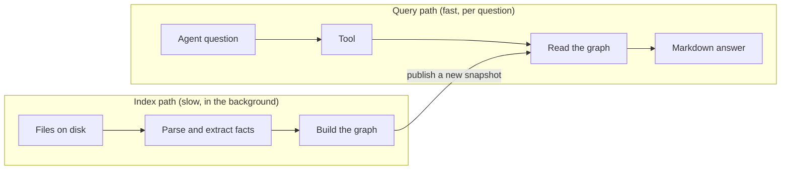

# 1. The big picture

## The problem in one paragraph

An AI coding agent explores a codebase like a newcomer: it searches text, opens files, and guesses
relationships from names. In one language and one repository that works. In a workspace of many
repositories and languages, the important relationships are *between* files that have no reason to
be opened together: a `.proto` contract implemented in Go, called from TypeScript, followed by an
event consumed in Python. MeshMCP reads the whole workspace once, keeps a small map of those
relationships in memory, and lets the agent ask the map instead of reading everything.

## What it is, physically

Two programs, built from one Rust workspace of four **crates** (a crate is a Rust library or
program):

| Program | Role |
| :--- | :--- |
| `mesh-mcp` | What the AI agent starts. Speaks the **MCP** protocol (JSON messages, one per line, over standard input/output). Also has command-line tools: `doctor`, `init`, `graph`, `stats`, `install-hooks`, `agent-guide`. |
| `meshd` | A background process ("daemon") that holds the index for one workspace. Several `mesh-mcp` sessions on the same workspace share it. Exits after 30 idle minutes. |

| Crate | Holds |
| :--- | :--- |
| `mesh-core` | Data types, the graph, configuration, the path jail, the crawler, the file watcher, the parse cache, the audit log. No tree-sitter code. |
| `mesh-parsers` | Everything that reads source code: tree-sitter grammars, one extractor per language, body stripping ("decapitation"), output formatting, graph rendering. |
| `mesh-server` | The `mesh-mcp` program: the message loop, the six tools, the indexer that builds the index, the command-line commands. |
| `mesh-daemon` | The `meshd` program: socket server, idle shutdown, Linux network sandbox, config-following host. |

The dependency direction is one-way: `mesh-daemon` uses `mesh-server`, which uses `mesh-core` and
`mesh-parsers`; `mesh-parsers` uses `mesh-core`; `mesh-core` uses neither.

## The two halves

Everything in MeshMCP belongs to one of two paths. Keeping them apart is the main design idea.

- The **index path** reads files, extracts facts, and builds a new graph. It can take seconds to
  minutes on a large workspace, and runs at low CPU priority so it does not disturb the editor.
- The **query path** only reads the finished graph. It never waits for the index path: it takes a
  **snapshot** (an immutable picture of the graph) and answers from it, even while a new snapshot is
  being built.

The two meet at one instant: the new snapshot is swapped in as a whole. A question therefore sees
either the old graph or the new one, never a half-built mix.

## The life of one question

The agent asks: *"who consumes the `orders.created` event?"*

1. The agent sends a JSON line to `mesh-mcp` on standard input: tool `analyze_impact`, argument
   `target: "orders.created"`.
2. `mesh-mcp` forwards the bytes to `meshd` over a local socket (or answers itself in
   `--standalone` mode).
3. The **tool registry** checks the arguments (unknown fields are rejected), consults the
   governance rules, and runs the tool on a worker thread.
4. The tool reads the current snapshot, finds the topic `orders.created` in the graph, follows its
   edges to producers and consumers, and builds a table.
5. The output is written as Markdown, cut at 48 KB if needed, and the call is appended to the audit
   log.
6. The reply goes back the same way. Every row carries `path:line`, so the agent can open the
   source and check.

Chapters 2 to 4 follow this path from the files at the bottom up to the answer.

## What the index contains, and what it does not

It contains **facts**, not code: where a class is declared, which module imports which package,
which method implements which RPC, which topic a function publishes to. Source text is read,
reduced, and dropped; the parsed syntax tree is not kept. (When a result is shown to the agent, the
function bodies are stripped too, a step called **decapitation**, so it sees signatures, not
implementations.)

It does not contain: types resolved by a compiler, call graphs inside a language, runtime values.
If a topic name is computed at runtime, no fact exists for it, and the answer says "not statically
resolved" rather than "none". [`../parser-support.md`](../parser-support.md) lists what each
language contributes.

## Glossary

| Term | Meaning |
| :--- | :--- |
| **MCP** | Model Context Protocol: how an AI agent calls tools on a server. Here, JSON messages over stdio. |
| **Tool** | One question the agent can ask: `smart_search`, `find_dependents`, `analyze_grpc`, `analyze_impact`, `search_docs`, `visualize_mesh`. |
| **Root** | A directory the configuration says to index. Also the security boundary: nothing outside the roots is readable. |
| **Workspace** | The set of roots described by one configuration file. |
| **Parse / tree-sitter** | Turning source text into a syntax tree. Tree-sitter is the C library that does it for many languages. |
| **Extractor** | The per-language code that walks a syntax tree and emits facts. |
| **Fact / `FileIndex`** | What an extractor produces for one file: declarations, imports, producers, consumers, RPC calls. |
| **Node** | One declared thing in the graph: a class, an RPC method, a topic, an HTTP route. |
| **Edge** | A connection between nodes: `Imports`, `Implements`, `CallsRpc`, `Produces`, `Consumes`. |
| **Confidence** | `exact`, `heuristic` or `ambiguous`: how the edge was matched. |
| **Graph** | All nodes and edges of the workspace. |
| **Snapshot** | An immutable picture of graph + doc index + properties at one moment. Has a generation number. |
| **Decapitation** | Replacing function bodies with a stub so a result shows signatures only. |
| **Jail** | The path check that refuses anything outside the roots. |
| **Daemon (`meshd`)** | The shared background process that owns the index. |
| **Guard** | A limit applied before parsing (file size, binary content, line length, nesting). |
| **Audit log** | A local, tamper-evident record of every tool call. |
| **RSAH / stop rule** | Optional governance: refuse or warn when a call concerns a guarded path. |

Next: [2. From files to facts](02-from-files-to-facts.md).
