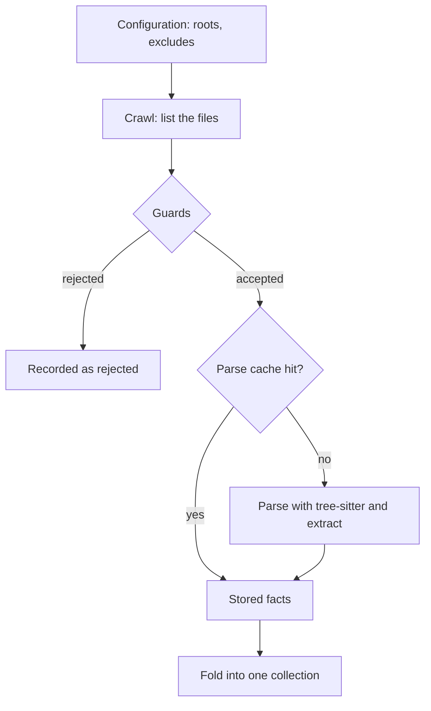

# 2. From files to facts

This chapter is the index path, from a directory on disk to a list of small facts per file. The
next chapter connects the facts.

## The steps



### Step 1: crawl

`crates/mesh-core/src/crawler.rs` walks each root. It never follows symbolic links, always skips
`.git`, and honours `.gitignore` and the `exclude_patterns` setting. Excluded directories are pruned
before they are entered, so listing `node_modules` costs nothing. Every file is tagged with the
number of the root it came from (a `RepoId`, a small integer).

Consequence worth remembering: a file that is git-ignored is never indexed, whatever other settings
say.

### Step 2: guards

Before the C parser is touched, `AstGuard` (`crates/mesh-parsers/src/guard.rs`) refuses:

| Check | Limit | Why |
| :--- | :--- | :--- |
| Size (read from file metadata, before reading) | 384 KB; 1.5 MB for `.proto`, protobuf-generated stubs and files named exactly `openapi`/`asyncapi` (`.yaml`/`.json`) | huge files are rarely hand-written source |
| Binary content | a null byte in the first 4,096 bytes | not text |
| Long lines | any line over 1,024 bytes | minified bundles |
| Nesting | bracket depth over 64 | the C parser could overflow its stack |

A refused file is not silently dropped. It is recorded with the one reason that fired and its
measurement (for example `long line (longest 4.1 KB)`), shown by `mesh-mcp doctor`, and named in
tool answers whose scope contains it, so the agent knows to read it directly.

### Step 3: parse and extract

The language is chosen from the file extension (`LanguageKind::from_path`). Tree-sitter turns the
text into a syntax tree. The language's **extractor** walks that tree and produces a `FileIndex`:

| Field | Contents |
| :--- | :--- |
| `nodes` | declarations: classes, interfaces, RPC services and methods, HTTP routes, topics |
| `dependencies` | which node imports which package or module |
| `producers` / `consumers` | which node publishes to or reads from which topic |
| `rpc_calls` | which node calls which RPC |
| `parse_failed` | whether the parse itself failed |

Then the syntax tree is dropped. Only the `FileIndex` is kept.

A parse that times out or fails is not treated as an empty file. It is counted as a failure,
retried once on its own outside the parallel pool, and if it still fails the file's last known-good
facts are kept on a reload.

The depth of extraction differs a lot by language: see
[`../parser-support.md`](../parser-support.md).

### Step 3b: a worked example

Two files in two repositories (illustrative):

```ts
// orders-service/src/publish.ts
import { Kafka } from 'kafkajs';
const kafka = new Kafka({ brokers: [] });
const producer = kafka.producer();
export async function announce() {
  await producer.send({ topic: 'orders.created', messages: [] });
}
```

```ts
// billing-service/src/listen.ts
import { Kafka } from 'kafkajs';
const kafka = new Kafka({ brokers: [] });
const consumer = kafka.consumer({ groupId: 'billing' });
export async function start() {
  await consumer.subscribe({ topic: 'orders.created' });
}
```

The TypeScript extractor produces, for the first file, roughly: a node `announce` (a function in
repository `orders-service`), and a *producer* fact "`announce` publishes `orders.created`". For
the second: a node `start` and a *consumer* fact "`start` reads `orders.created`". The rule that
recognised `producer.send` only fired because the file imports `kafkajs` and built the `producer`
from a Kafka client; the same `.send(...)` in a file without that import would produce nothing.
That gating is how the extractor avoids calling every `.send()` a message broker call.

At this stage the two files know nothing about each other. Chapter 3 connects them.

### Step 4: the parse cache

Parsing is the expensive part. `crates/mesh-core/src/index_cache.rs` stores each file's `FileIndex`
in a SQLite database, keyed by file path, content hash, root number and a fingerprint of the
extraction settings. If all four match a stored entry, tree-sitter is skipped. This is why
restarting, or switching back to a branch seen before, does not re-parse everything.

- One database per workspace, under `~/.cache/mesh-mcp/workspaces/<id>/`.
- A disk quota (`[cache] max_size_mb`, default 2048); least recently used entries are evicted first.
- It is a pure performance cache. Deleting it is always safe.
- The key includes the file path, so identical files at two different paths are two entries.

### Step 5: fold

The per-file results are combined into one collection, sequentially, in a fixed order. Extraction is
parallel (many files at once on a pool of threads), but the combining step is not, because the
result must be the same no matter which file finished first. That determinism is tested: indexing
the same content twice, in different orders and with concurrency, must give the same fingerprint
(`scripts/determinism.sh`).

## Other kinds of files

Not everything goes through tree-sitter:

| File | Handled by |
| :--- | :--- |
| `.proto` | tree-sitter-proto: services, methods, messages, imports |
| OpenAPI / AsyncAPI YAML, Spring `application*.yml` / `.properties` | a streaming YAML reader with memory budgets; Spring values that look like secrets are masked |
| Markdown | split into sections for `search_docs`, under a per-file memory budget |
| `.vue`, `.svelte`, `.astro` | their `<script>` blocks are extracted with the JS/TS grammars; everything else is blanked so line numbers stay the file's |
| Custom regex patterns from the configuration | applied to files by name pattern, to describe conventions the built-in extractors do not know |

## Key ideas to keep

- Facts are small and per file; no fact refers to another file yet.
- The guards make "could not index" an explicit, reported outcome.
- The cache makes the second boot cheap, and its key makes it correct.
- Determinism is a design requirement, enforced by a test.

Next: [3. The graph](03-the-graph.md).
