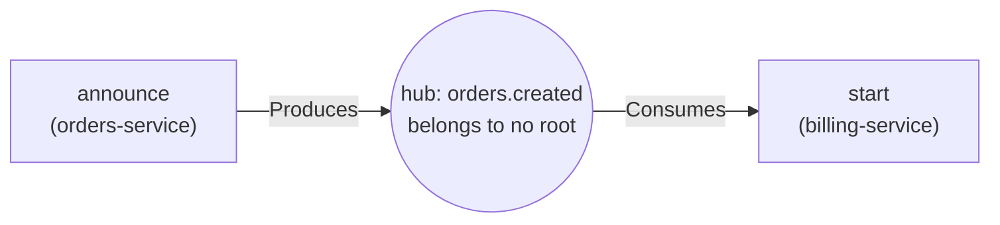

# 3. The graph

Chapter 2 ended with independent facts per file. This chapter connects them into one graph that the
tools can walk. The code is mostly `crates/mesh-core/src/contracts.rs` (type `ContractGraph`) and
`crates/mesh-core/src/types.rs`.

## Nodes and edges

A **node** is a declared thing: a class, an interface, a gRPC service or method, an HTTP route, a
topic, a queue, a proto message. It has a name, a kind, a file and line range, a package, the number
of the root it lives in, and often a signature.

An **edge** connects two nodes. There are five kinds in use:

| Edge | Meaning | Example |
| :--- | :--- | :--- |
| `Imports` | this node depends on that package or symbol | `PaymentController` imports `@shop/domain-user` |
| `Implements` | this handler serves that RPC | a Go function serves `PaymentService.ProcessPayment` |
| `CallsRpc` | this client code calls that RPC | a TypeScript class calls `ProcessPayment` |
| `Produces` | this code publishes to that topic | `announce` publishes `orders.created` |
| `Consumes` | that topic is read by this code | `orders.created` is read by `start` |

(A sixth kind, `DispatchesTo`, still exists in the type but is no longer built: it connected every
producer to every consumer of a topic, which grows with the square of the number of participants.
The same information is the two-hop walk producer -> topic -> consumer.)

## Confidence

Not all matches deserve the same trust, so every edge says how it was found:

| Confidence | Meaning |
| :--- | :--- |
| `exact` | a fully qualified match, or a structure derived from the node itself (for example a producer registered for a topic) |
| `heuristic` | a bare-name, case-insensitive or substring match; a custom regex pattern unless it declares itself exact; a client bound only to a service, not to the method |
| `ambiguous` | several candidates tied; one edge per candidate is kept so the agent sees the choice |

Tools print the confidence on each row. The convention for the reader of an answer: `exact` can be
used, `heuristic` and `ambiguous` are leads to confirm by opening the `path:line` shown.

## Reconciliation: turning facts into edges

When all per-file facts are in, one pass called **reconcile** rebuilds every edge from scratch. It
runs once per snapshot, after everything has been folded in, and always clears the old edges first.
Rebuilding rather than patching is deliberate: it means an incremental update (only the files that
changed) ends up with exactly the same graph as a full rebuild, because an unchanged file's edge to a
re-indexed target is recomputed instead of left stale.

The stages, in order:

1. **Imports.** Each recorded import is resolved against the declared nodes. It tries a fully
   qualified name first (`exact`), then an exact bare name (`heuristic`), then, for a relative
   import, the file stem within the importer's own root, then the package identifier. An import of an
   external package nobody declares (`@nestjs/common`) produces no edge. For JavaScript and
   TypeScript, a relative import links to the file it names (extension-, `index`- and
   component-folder-aware), and path aliases from `tsconfig` / `package.json` are rewritten before
   this step.
2. **Topic hubs.** For each topic name that has producers or consumers, a hub node is found or
   created. It belongs to no root (a reserved sentinel number, so that no real root is credited with
   every topic).
3. **Produces / Consumes.** Producer -> hub, hub -> consumer, both `exact`.
4. **Implements.** Handlers to their proto RPC declarations: `exact` on a fully qualified match,
   `heuristic` on a PascalCase or substring match.
5. **CallsRpc.** Client call sites to proto methods, same split. The standard gRPC health service is
   filtered out as infrastructure.

A **hub** is a node the graph creates for each topic name so that every producer and consumer meets in
one place.

### Continuing the example

From chapter 2 the facts were: `announce` publishes `orders.created` (repository `orders-service`),
`start` consumes `orders.created` (repository `billing-service`). Reconcile creates a hub node for
`orders.created`, an edge `announce --Produces--> hub` and an edge `hub --Consumes--> start`. Now
`analyze_impact(target: "orders.created")` can list `announce` as producer and `start` as consumer,
classify each row as `INTERNAL` or `EXTERNAL` relative to the owner of the event (the roots of its
producers), and with `depth: 2` follow what `start` itself publishes next.

### The same idea in Java

A Spring service with `@KafkaListener(topics = "orders.created")` on a method gives a consumer fact for
that method; a `kafkaTemplate.send("orders.created", ...)` in another repository gives a producer fact.
If the topic is written as `${app.topics.orders}` the Java extractor resolves the placeholder through
the Spring `application*.yml` / `.properties` files when `resolve_placeholders` is on; a constant
(`Topics.ORDERS`) is not resolved. Reconcile then links them through the same hub as above. An import
works the same way: `import com.acme.billing.Invoice;` is a fully qualified name, so it resolves
`exact` to the declared `Invoice` in the repository that has it.

### Topic naming

A topic key is lower-cased. A code reference to a constant such as `Streams.EVENT_CREATED` keys on
the member alone (`event_created`), so a producer and a consumer that spell the same topic
differently still meet. A broker literal such as `orders.created` is kept whole. In JavaScript and
TypeScript, the extractor resolves literals, templates, constants and enums inside the file; an
imported constant is passed to the graph as written to be reduced here.

## Wildcards and relays

A NATS subject with `*` or `>`, or an MQTT topic with `+` or `#`, is linked to the producers of every
concrete subject it matches, at `heuristic` confidence, up to 256 producers per subscription. A relay
is never linked to its own subscription.

## Indices (for contributors)

To answer quickly, the graph keeps several lookup tables built from the nodes: by name, by package,
by file, by fully qualified name, reverse dependencies, topic producers, topic consumers. Anything
that adds to one must be added in the single function that inserts a node and removed in the single
function that purges a file, or a reload leaves stale entries. Node numbers are assigned in fold
order and are not stable between generations; do not store them.

## Determinism

Iteration order in the graph is fixed (ordered maps rather than random hashing), so the same input
gives the same output. `mesh-mcp graph --format fingerprint` prints a content hash of the whole index
that does not depend on where the checkout lives. CI indexes each example workspace five times in
sequence and eight times concurrently and requires one fingerprint.

## What the graph does not model

- HTTP clients calling routes: a route has its handler and the edges on it, but no caller edge.
- Test coverage: tests are not linked to the code they exercise.
- Anything resolved only at runtime.

Next: [4. Answering a question](04-answering-a-question.md).
