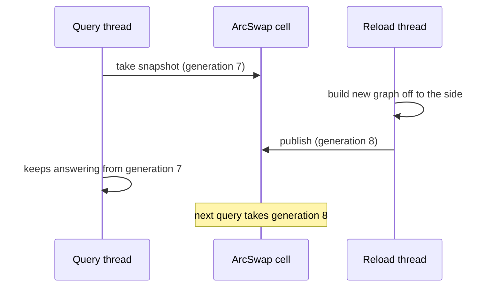
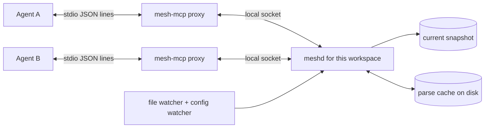

# 5. Processes and time

Chapters 2 to 4 described the index and the query as if nothing changed. In reality files change,
several editors connect, and the configuration is edited. This chapter is about those moving parts.

## Two ways to run

| Mode | What happens |
| :--- | :--- |
| `mesh-mcp run` (default) | A thin proxy. It finds or starts the `meshd` for this workspace and copies bytes between its standard input/output and the daemon's local socket. |
| `mesh-mcp run --standalone` | Everything in one process: no daemon. For containers and CI. |

If the daemon dies mid-session, the proxy exits with status 1 and logs where the daemon log is. If
it cannot connect right after a successful liveness check, it falls back to standalone.

## One daemon per workspace

The daemon is found through a **workspace id**: the first 16 hex characters of a SHA-256 of the
configuration's canonical base directory plus the binary's version. The socket is
`meshd-<id>.sock` (a Unix socket, mode `0600`, in a `0700` directory) or a named pipe on Windows.

Consequences:

- Two editor windows on the same repository share one index.
- Two different repositories never share a daemon, even if both run at once.
- Upgrading the binary changes the id, so a stale daemon from the old version is never found again.
  Before spawning, `mesh-mcp` checks the sibling `meshd`'s version and serves in-process on a
  mismatch instead of using an old daemon.
- The daemon opens its socket immediately and indexes in the background. A tool call that arrives
  before the first snapshot gets an explicit "still indexing" error, not an answer from an empty
  graph.
- It exits after 30 idle minutes, and has a startup grace deadline so an orphaned daemon does not
  linger.

## Snapshots: how the swap works

All state a query reads lives in one immutable `MeshSnapshot`: the graph, the doc index, the property
registry, a `generation` number and index health. It is held in an `ArcSwap`, a cell whose content
can be replaced atomically while readers keep using the old value.

`ArcSwap` is, in TypeScript terms, a variable holding an immutable object that one thread can replace atomically while others keep using the object they already read. A reader never waits for a writer, and never sees a new graph beside an old doc index. Writers take
turns with a lock, which readers never touch.

## Watching files

The watcher (`crates/mesh-core/src/watcher.rs`) turns file events into reloads:

- Events are debounced for 150 ms and a burst is coalesced into one reload.
- The changed paths go to the indexer, which re-reads only those files. A change to Git references
  or `HEAD`, a directory event, or a path whose parent is gone falls back to a full **differential
  reload**: crawl again, then re-read only files whose size or modification time changed, confirmed by
  content hash (so a bare `touch` changes nothing).
- On macOS, one recursive FSEvents stream per root. On Linux and Windows, one watch per directory,
  capped at 2,048 across all roots, beyond which it falls back to polling (and Linux may also hit
  the system's inotify limit, which `doctor` checks).
- **Git operations.** The watcher resolves each root's real Git directory (following `gitdir:` for
  linked worktrees and submodules). While a checkout or rebase is in progress (`index.lock`,
  `rebase-merge/`, `rebase-apply/`, or `HEAD` moving) it holds reloads, then installs one generation
  when things settle, for at most 60 seconds. Answers given meanwhile come from the last complete
  snapshot and start with a note naming its generation.

## Files the guards refused

A refused file never enters the file cache, so it would look changed on every reload and be re-read
each time. The indexer instead remembers each refused file with the file stats it had before it was
read, and reads it again only when its modification time or size changes.

## The daemon follows its configuration

Editing `mesh-mcp.toml` needs no restart. On a request, at most every 250 ms, the daemon reads and
hashes the config file. If the hash differs, it builds a whole new state on a blocking thread while the
old one keeps serving, then swaps it in once the first snapshot is ready. A config that does not parse,
or whose roots do not resolve, is refused: the old state keeps serving, a warning is logged, and
`mesh-mcp doctor` shows the refusal.

How much work the swap costs depends on what changed:

| Edit | Kind | Work |
| :--- | :--- | :--- |
| display-only keys (route prefix, name, policy, docs vocabulary) | `display-only` | swap the config over the running index; no file read |
| a custom contract pattern | `partial` | re-extract only the files that pattern applies to |
| anything else (roots, excludes, engines) | `full` | rebuild the index, reusing the parse cache for unchanged files |

The classifier is written so that adding a config key is a compile error until the key is classified,
and tests check an incremental result equals a full rebuild. There is no timer: an edit made while
nobody talks to the daemon is applied by the next request.

A workspace that resolves to `/`, a drive root or the home directory, with no config file, is refused
before any daemon starts; the session answers every call with an error naming the directory.

## Topology at a glance

## Defaults in one place

| Setting | Value |
| :--- | :--- |
| Watcher debounce | 150 ms |
| Config file check | at most every 250 ms, on a request |
| Git operation hold | at most 60 s |
| Watched directories (Linux, Windows) | 2,048 across all roots, then polling |
| Daemon idle shutdown | 30 minutes |
| Parse cache quota | 2048 MB per workspace (`[cache] max_size_mb`) |
| Output cap | 48 KB; `smart_search` page about 8 KB |
| Message channel | 64 frames |

## Priorities: being polite

Indexing must not make the editor lag. The first scan at boot runs at normal priority, because
someone is waiting. Watcher-triggered rescans run on a dedicated thread pool at the lowest class
(a scheduling priority the operating system gives the threads: `QOS_CLASS_BACKGROUND` on macOS, nice 10 on Linux, below-normal on Windows). The one reload a request
is waiting for, after a config edit, runs on a second pool at an intermediate class
(`QOS_CLASS_UTILITY`, nice 5) because the background class can be starved for minutes on a busy machine.

## Two kinds of threads

The program uses two thread systems for different jobs; chapter 7 explains the Rust side.

- **Tokio** runs the message loop and the sockets: many lightweight tasks, so waiting for input costs
  nothing. Anything that blocks is sent to Tokio's blocking pool.
- **Rayon** runs the indexing: many files parsed in parallel on a pool of worker threads.

## The persistent cache and disk

Covered in chapter 2. In this chapter's terms: the cache lives beside the daemon's workspace id, so
it changes with the binary's version; the machine-wide cache used up to 6.x is no longer
read, and `doctor --fix` removes it.

Next: [6. Safety and limits](06-safety-and-limits.md).
